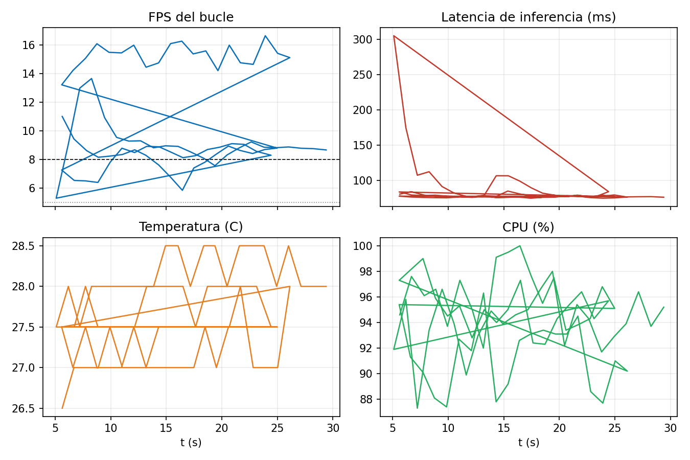
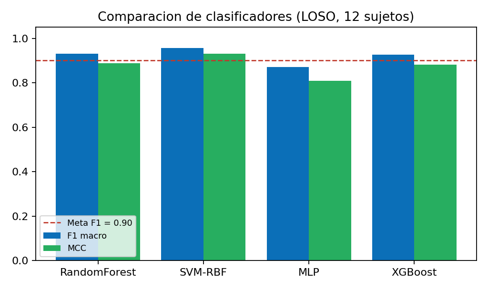
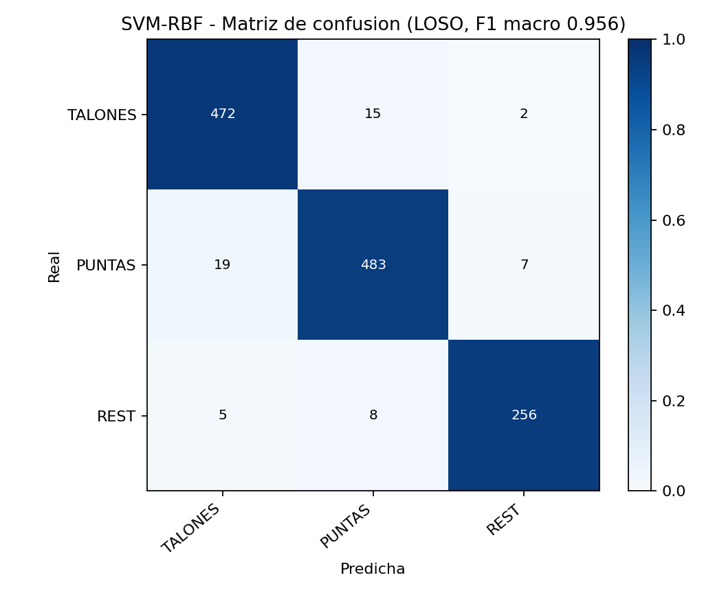
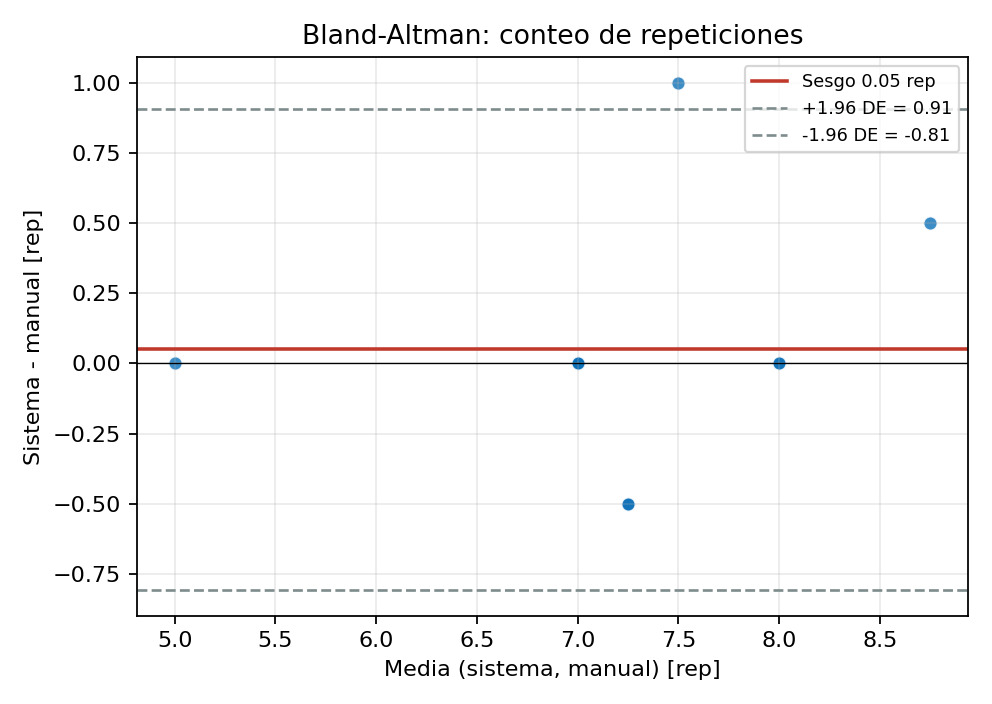

# Reconocimiento y Monitoreo Biomecánico de Elevación de Talones y Puntas en Plataforma Embebida

Proyecto de Prácticas Profesionales de Carrera — **Ingeniería en Computación (UAZ)**  
- **Institución Receptora:** Centro de Investigación en Matemáticas, A.C. (CIMAT), Unidad Zacatecas  
- **Practicante:** David Guadalupe Soto Aldaba  
- **Supervisor Académico:** Dr. Hugo Arnoldo Mitre Hernández  
- **Documentos Oficiales:** [Plan de Trabajo](Plan_Trabajo_Practicas_David_Soto_CIMAT.pdf) | [Reporte Técnico Final](Reporte_Tecnico_Final_Practicas_David_Soto.docx)

---

## 📌 Descripción del Proyecto

Sistema embebido en tiempo real para el reconocimiento y conteo automático de repeticiones en ejercicios de rehabilitación del tren inferior:
- **Elevación de talones** (*flexión plantar* — sóleo y gemelos)
- **Elevación de puntas de pie** (*dorsiflexión* — tibial anterior)

Implementado sobre una **NVIDIA Jetson Nano (4 GB)** con aceleración **TensorRT FP16**, utilizando el estimador de pose **HRNet WholeBody**, que provee los puntos articulares específicos del pie (talón, dedo gordo y dedo pequeño). El sistema se encuentra unificado con las pruebas de sentarse-levantarse (STS) y abducción de cadera (ABD).

---

## 🎯 Cumplimiento de Metas (Tabla de Indicadores del Plan)

| Indicador | Meta del Plan | Resultado Obtenido | Estado |
| :--- | :---: | :---: | :---: |
| **Error Absoluto Medio (MAE)** | $\le 0.50$ rep | **0.25 rep** | ✅ Cumple |
| **Series con error $\le 1$ rep** | $\ge 90.0\%$ | **100.0%** | ✅ Cumple |
| **F1 Macro de clasificación** | $\ge 0.900$ | **0.956** | ✅ Cumple |
| **Concordancia Temporal (ICC)** | $\ge 0.750$ | **0.922** | ✅ Cumple |
| **Tasa sostenida de procesamiento** | $\ge 8.00$ FPS | **8.84 FPS** | ✅ Cumple |
| **Piso de procesamiento (p5)** | $\ge 5.00$ FPS | **6.53 FPS** | ✅ Cumple |
| **Tamaño del clasificador** | $\le 300.0$ KB | **267.0 KB** | ✅ Cumple |

---

## 📊 Evidencia Experimental y Resultados

### 1. Desempeño en Tiempo Real (NVIDIA Jetson Nano 4 GB)
El sistema sostiene más de 8.8 cuadros por segundo con un consumo térmico estable menor a 30 °C y sin desbordamiento de memoria RAM:



### 2. Comparación de Clasificadores y Matriz de Confusión (LOSO)
Se evaluaron cuatro modelos mediante validación cruzada dejando un sujeto fuera (*Leave-One-Subject-Out*). El clasificador SVM con kernel RBF alcanzó un F1 macro de 0.956 con una huella en disco de solo 267 KB:

| Comparación de Modelos | Matriz de Confusión (SVM-RBF) |
| :---: | :---: |
|  |  |

### 3. Acuerdo Clínico con Observadores Humanos (Bland-Altman)
El análisis de concordancia demostró un sesgo prácticamente nulo (+0.05 repeticiones) y todas las series dentro de los límites de acuerdo de $\pm 1.96$ desviaciones estándar:



---

## ⚙️ Compilación del Motor TensorRT (`hrnet_wb_fp16.engine`)

Por motivos de compatibilidad de arquitectura de GPU (hardware-specific), el motor de inferencia TensorRT debe generarse en la propia tarjeta destino.

> 📖 **Guía completa y detallada paso a paso:**  
> Consulta el documento [GUIA_GENERAR_ENGINE_TENSORRT.md](GUIA_GENERAR_ENGINE_TENSORRT.md) para ver la preparación de memoria swap, modo 10W (`nvpmodel`), resolución de errores y parámetros óptimos.

**Comando rápido con `trtexec` en la Jetson Nano:**
```bash
/usr/src/tensorrt/bin/trtexec \
  --onnx=hrnet_w48_coco_wholebody.onnx \
  --saveEngine=hrnet_wb_fp16.engine \
  --fp16 \
  --workspace=1024
```

---

## 🚀 Puesta en Marcha

### 1. Dependencias
```bash
pip install -r requirements_jetson.txt
```

### 2. Inferencia en Vivo
```bash
# Cámara USB
python hrnet_jetson_pipeline_unificado.py --engine hrnet_wb_fp16.engine --camera 0 --skip 2

# Video pregrabado
python hrnet_jetson_pipeline_unificado.py --engine hrnet_wb_fp16.engine --video prueba.mp4
```

### 3. Re-entrenamiento y Validación
```bash
python train_exercise_classifier.py
python evaluacion_final_plan.py
```

---

## 🌐 Panel Clínico Web (Dashboard)
El archivo `index.html` (o `dashboard_pacientes.html`) permite visualizar el progreso de las sesiones de los pacientes de forma interactiva directamente desde el navegador o mediante GitHub Pages.
